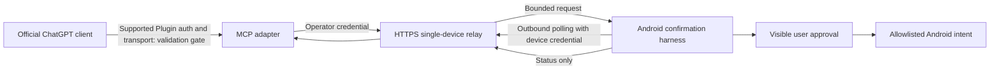

# Architecture decisions

## ADR-001: A small GrapheneOS derivative

Recommend the maintained Pixel hardware/security integration of GrapheneOS as
the upstream, subject to the evidence in [the foundation comparison](os-foundation.md).
Our distribution owns its names, signatures, updater endpoints, build records,
and release responsibility. Upstream signed OTA packages cannot update our
modified, differently signed OS. Each upstream release is imported, rebuilt,
validated, and signed by us. Initial changes should be ordinary apps and small
product configuration patches; no broad framework fork is justified yet.

## ADR-002: Preserve the official app boundary

Use the OpenAI-signed app from Google Play. The launcher invokes its ordinary
launcher Activity through Android package resolution and exposes the fixed Play
listing for installation/updates under settings. Keep the full standard Android
Settings app accessible, with Play serving app maintenance rather than a
store-browsing home experience. The Play Store itself remains unmodified and can
show its ordinary UI when opened. Play updates the app independently of OS OTA.
The UI is not embedded, intercepted, scraped, or cloned. No API subscription is
assumed to be interchangeable with the user's ChatGPT subscription.

## ADR-003: Outbound relay, explicit device approval

The initial runnable MCP adapter and relay are independently testable without
access to the official app. The first edge is **not demonstrated** in this
checkout. The development MCP endpoint must not be exposed publicly as a
substitute for supported OAuth/private transport setup.

The phone initiates the network connection, so no cloud service attempts to
reach phone localhost. Android's restrictions on background execution and
background Activity launches are respected: the prototype uses a foreground
screen. A later OS service needs separate lifecycle, notification, locked-device,
battery, revocation, and privacy decisions before it can replace this harness.

## ADR-004: Conservative results and at-most-once attempts

An intent handoff cannot prove downstream completion. Persist the attempt before
dispatch, keep a request journal, and report ambiguity after interruption. Never
automatically retry an ambiguous side effect. The user must approve a new request
if they decide to retry. The narrow schema and local confirmation remain in force
even if a future model or client claims a request is already authorized.

## ADR-005: Separate compilation, physical validation, and signing

The dev server compiles components and OS candidates. The owner's **dev Pixel**
performs hardware and official-app validation after approval. An isolated signing
process holds production keys. KVM/emulation is optional and unnecessary for the
physical-device workflow. Public pull-request CI never receives production
credentials or access to a signing host.
