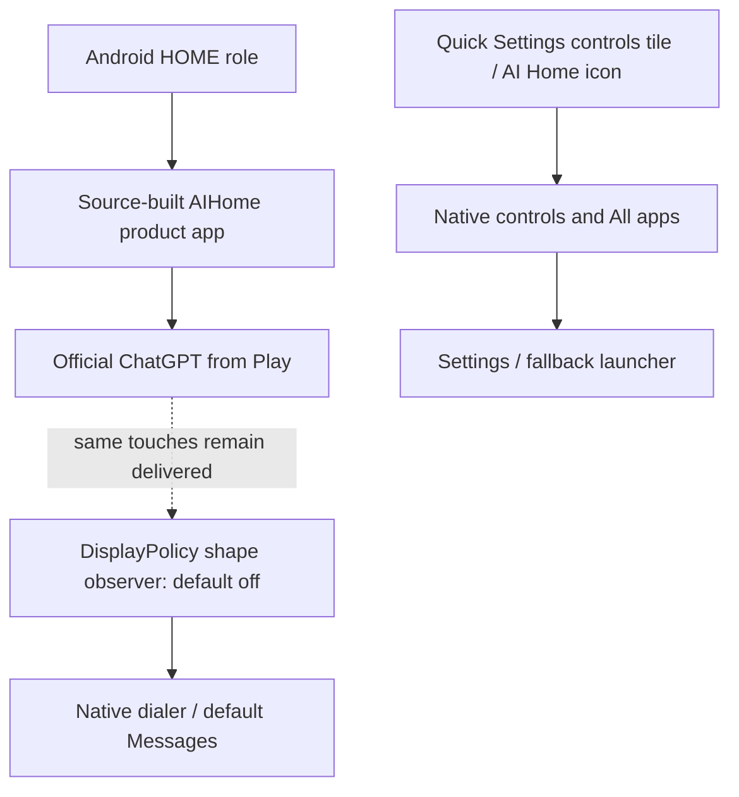

# Architecture decisions

## Current scope: replacement OS

The target is a GrapheneOS-derived Android distribution for Pixel 9a
(`tegu`), with official ChatGPT as the main conversational experience and
normal Android Phone, Messages, Settings and recovery. The standalone launcher
APK remains a component test harness; it does not satisfy the OS target.
MCP and cosmetic refinement are deferred.

## Product integration

[os/product](../os/product/README.md) supplies the Soong `AIHome` module and
product overlays. A small framework resource and PermissionController HOME-role
patch select AI Home for a fresh role with no existing holder; they do not
overwrite an existing user-selected launcher at every boot. The product sets
`chatgpt_on_home_default=true`; the standalone APK retains its false default,
and an explicitly saved preference takes precedence.

The app opens ChatGPT through ordinary Android launching. Its icon and optional
Phone controls tile open native controls instead. Missing/unlaunchable ChatGPT
leaves recovery visible. Launcher3/Quickstep, Settings, dialer, Messages, Clock,
keyguard and notifications remain included. The user can disable ChatGPT-on-Home
or select another launcher in stock Settings.

The product sources are incorporated as reviewed Git patches within the pinned
`vendor/adevtool` project. Generated vendor files are separately inventoried;
they are not an excuse for untracked product changes.

## Framework shape observer

[os/framework](../os/framework/README.md) attaches an observer through the
pinned `DisplayPolicy` source. [os/gestures](../os/gestures/README.md) contains
the platform-independent recognizer with 239 synthetic assertions. One completed
single-finger triangle opens `ACTION_DIAL`; a square opens default Messages.
Neither places a call nor sends a message. There is no edge hold, second finger
or per-stroke activation step.

The secure setting `aifirst_shape_gestures_enabled` defaults to zero. Recognition
is restricted to the unlocked owner user, default display and eligible focused
ChatGPT window. Keyboard, obscuring/system windows, calls, context changes,
cancellation and multitouch invalidate recognition/handoff according to the
controller's checks.

**This is passive observation.** Touches still reach ChatGPT and may produce
scrolling, selection or other partial interaction. The patch does not arbitrate
or cancel app input. Enabling it by default requires full framework compilation
and hardware evidence about false activation, latency, accessibility and
lock/call transitions. Synthetic geometry/session tests are not that evidence.

## Official app and system boundaries

The OpenAI-signed ChatGPT app is installed/updated through its official Play
listing; it is not bundled, modified, embedded or scraped. Account,
subscription, conversations and Voice remain within the official app. No
undocumented Voice-start contract or private ChatGPT endpoint is assumed.

Android retains call presentation, messages, notifications, volume, lock screen,
emergency access and full Settings. The controls tile is system-bound rather
than an overlay or always-on daemon. The framework observer is an OS source
change, not a permission granted to the standalone APK. Neither component
introduces a remote device-control service.

MCP is deferred. If revisited, the user's requirement remains on-Pixel MCP and
execution with no project-operated cloud relay. That research does not block
current OS integration.

## Source, build and release boundaries

`scripts/prepare-os-integration.py` assembles three canonical patches using
`os/integration-base.json`: exact manifest/project revisions and SHA-256 values
for the changed upstream files. This small-source check does not compile or
verify a complete upstream project. Full source import, patch application,
vendor generation and Soong compilation remain distinct steps.

The explicit development profile uses `os/development-lock.json` and a
`userdebug`-only wrapper. It retains source/patch/generated-input verification
without requiring production keys or an update service. The production lock,
`user` build, own update identity, signing and physical release evidence remain
separate and strict. Capturing an inventory never approves its provenance.

The current 16 GiB RAM / roughly 29 GiB disk workspace cannot perform a full OS
sync/build. The cloud environment prepares source and checks; a suitable
compilation runner produces the eventual images, and the local MacBook/dev
Pixel provide separately approved hardware tests. No OS image, boot or flash is
established by the current source checks. See [OS integration](os-integration.md).
