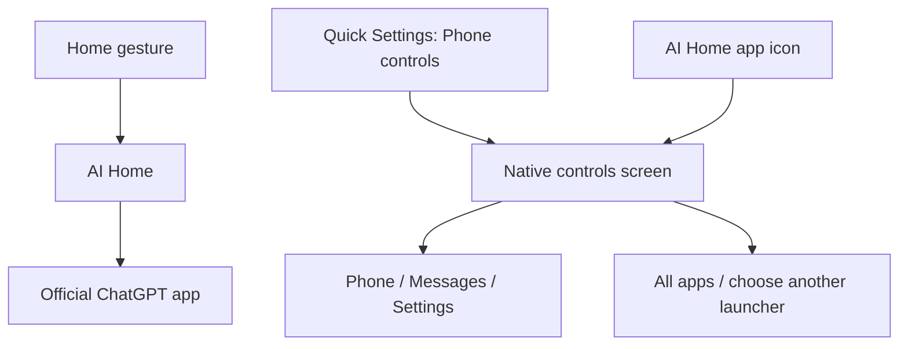

# Architecture decisions

## Current scope: ChatGPT Home and native controls

AI Home is an ordinary Android launcher on the dev Pixel's existing OS. When
enabled as the default Home app, it opens the official ChatGPT app on a fresh
Home request. Returning from Phone, Messages, or Settings does not trigger an
automatic redirect. A missing or unlaunchable ChatGPT leaves controls visible.

The user adds the optional Quick Settings tile through Android's normal UI.
Android binds its `TileService` when needed; it is not an always-running
background daemon. There is no overlay, notification listener, accessibility
service, device-admin mode, or remote relay in this UI path.

Android continues to handle incoming calls, messages and their notifications,
volume, quick settings, lockscreen, and emergency calling. Phone opens the
dialer; Messages opens the messaging app. AI Home neither places calls nor
reads or sends messages itself. Those actions happen in the native apps.

## Preserve the official app and recovery paths

Use the OpenAI-signed app from Google Play. Resolve its ordinary launcher
Activity through Android's package manager; do not depend on private Activity
names, endpoints, or a Voice-start contract. Keep the full Android Settings app
accessible, and expose the official ChatGPT Play listing for updates. Play
remains unmodified and can show its ordinary UI when opened.

The ChatGPT UI is not embedded, intercepted, scraped, or cloned. The launcher
does not read conversations or provide AI control of the phone. The user's
ChatGPT subscription stays with the official app.

**ChatGPT on Home** is an explicit preference. The AI Home app icon and tile
open controls even while that preference is enabled. Android's system Settings
also retains its normal default-home selection, allowing return to Pixel
Launcher. No kiosk restrictions prevent exiting the prototype.

## MCP is deferred

The UI prototype has no MCP setup or connection requirement. The earlier
Python relay and protocol code remain as historical reference. If tool control
is revisited, the user's constraint remains that MCP and device execution run
on the Pixel, with no project-operated cloud relay. The official app's ability
to connect to that service remains unproven; this is not a gate for the UI work.

## Build environment and possible OS milestone

The modest cloud dev server compiles the APK. The local MacBook transfers it to
the local dev Pixel, which supplies physical validation. No full Android source
build or emulator is required for this phase.

A future replacement OS would use the maintained Pixel hardware integration of
GrapheneOS as the proposed upstream, subject to the [foundation review](os-foundation.md).
Our distribution would own its names, signatures, updater, and release
responsibility. That requires separate source, signing, hardware, and OTA
validation; the current APK does not provide them.
