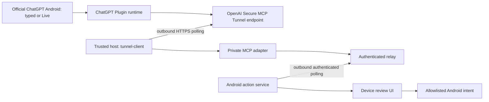

# Official ChatGPT integration feasibility

Research date: **2026-10-11**. This is a documented-capability assessment, not a report of account or phone tests. No ChatGPT account settings or physical device were changed for this assessment.

## Decision

Use the unmodified official ChatGPT Android app for conversation, account access, memory, subscription features, and Voice. Build a small launcher and independently authenticated Android action service around it. The supported integration candidate is a **Plugin containing an MCP server**, reached through a private Secure MCP Tunnel or an authenticated public HTTPS service, with the phone making an outbound authenticated connection to a relay.

Current official documentation supports mobile Plugins and, in a dated September 23, 2026 release note, Live Voice using available plugins on Android. That makes the requested integration a credible candidate, **not a demonstrated capability for this user's account, this custom plugin, or Pixel 9a**. Older official pages still describe incompatible restrictions. Gate production work on the account/client tests in [account-device-validation.md](account-device-validation.md).

An installable launcher and working local protocol tests do not establish that ChatGPT can invoke the bridge. A replacement OS additionally needs validated app compatibility on that OS, device builds, signed updates, and physical-device release tests.

The user supplied the official Play listing and has a development Pixel available for future tests. Use [that official listing](https://play.google.com/store/apps/details?id=com.openai.chatgpt) for installation and updates after approval. Do not bundle or redistribute the proprietary APK inside our OS images. On a GrapheneOS-derived build, install supported sandboxed Google Play components and ChatGPT in the **same profile**; GrapheneOS documents that only apps in that profile can use Play [A7]. Keep ChatGPT app updates and supported Play-component updates independent of our OS OTA pipeline. This is the intended compatibility path, not proof that our future build passes all app/account/integrity checks. The ChatGPT account plan and custom-Plugin eligibility remain unknown.

## Capability matrix

`Documented` means a primary source describes the capability. `Conditional` means access, rollout, transport, or client behavior must be checked. `Unproven` means no end-to-end evidence was obtained here.

| Capability | Documented platform support | Account / Android availability | Demonstrated here / decision |
| --- | --- | --- | --- |
| Open official ChatGPT | Android's `PackageManager.getLaunchIntentForPackage` obtains a package's launch activity [A1]. OpenAI's Play listing is `com.openai.chatgpt` [A2]. | Requires the genuine app to be installed, enabled, visible to our app, and launchable. | Physical launch unproven. Use the standard launch intent and handle absence/failure; never hard-code internal activity names. |
| Preserve normal ChatGPT account and history | The official app synchronizes history across devices [A2]; Android FAQ exposes history and settings [A3]. | Use the existing ChatGPT account and correct workspace. Subscription, memory, and Voice remain governed by that account and OpenAI settings. | Unproven on our OS. No account migration, new subscription, cookie copy, or memory export is part of the bridge. |
| Use official app on an AOSP-derived OS | Android FAQ defers current compatibility to the Play listing and documents Chrome/Brave login dependencies [A3, A4]. | No reviewed primary source certifies our future signed Pixel 9a build. Google Play availability, login, app updates, and any integrity checks need testing. | Compatibility release gate. Do not claim that AOSP compatibility alone proves official-app compatibility. |
| Typed conversation uses a Plugin | Current Plugin help and ChatGPT Learn describe Plugins in Chat and Work on web, desktop, and mobile [P1, P2]. | Plugin capabilities, plan, workspace permissions, role, region, and client surface all matter. Desktop-only plugins do not become mobile tools merely by saving them to an account. | Official account/client invocation unproven. Prefer a remote MCP capability, not a desktop-local command. |
| Create a private custom MCP Plugin | Current guide supports read and write tools, SSE / streaming HTTP, web setup, and a URL or Secure MCP Tunnel [P3]. | Creation and use remain subject to workspace restrictions including Lockdown. A visible directory is not proof of custom write-tool entitlement. | Unproven. First validate creation, installation, authentication, tool discovery, and read/write access on the actual account. |
| Legacy developer-mode MCP app | Legacy help says Business / Enterprise / Edu have full MCP on web, Pro read/fetch only, and mobile: “No - web only.” [P4] | This conflicts with newer Plugin guidance if treated as a universal restriction. It may describe a different product path. | Do not infer either mobile support or blanket impossibility from this page alone. Record which UI/path the account actually exposes. |
| Mobile Live Voice calls our tools | September 23, 2026 release notes: “Live now supports plugins on web, iOS, and Android.” [V1] | Only plugins and connected apps available to the account; existing permissions and limits apply. Voice and Work access are separate when using Work. | **Unproven, independently gated from text.** A dictated text prompt is not a Live Voice test. |
| Advanced / Standard Voice, custom GPT Actions | Voice help distinguishes Live, Advanced, Standard, and dictation; custom actions are not available in Voice conversations with GPTs [V2]. | A Live Plugin announcement is not evidence for legacy GPT Actions or every other Voice mode. | Do not promise these paths. Record exact Voice mode and surface in each test. |
| Start Voice automatically | Official Voice help documents user-controlled **Settings → Voice → Start with Voice**, on supported mobile versions, when opening a new or empty conversation [V2]. | Conditional on setting, account/client support, and conversation state. Launching may resume an existing conversation. | No external Voice-start intent is established. Our launcher only opens the official app; it cannot promise Voice startup. |
| Wake word / embed ChatGPT / read its private chats | No reviewed primary source provides these integration contracts for our launcher. A Plugin can receive tool inputs chosen by ChatGPT; that is not general access to its conversations or memory. | No assumed entitlement. | Out of scope: no proprietary APK changes, reverse engineering, authentication-token extraction, accessibility scraping, or private endpoints. |
| Cloud calls phone `localhost` | `localhost` belongs to the machine making the request; OpenAI documents remote MCP and private network tunnel paths [T1]. | Carrier NAT, sleep, and changing networks make a phone-hosted public listener unsuitable as the default. | Choose outbound phone → relay transport; do not advertise a phone loopback URL to ChatGPT. |
| Secure MCP Tunnel | Official client long-polls OpenAI over outbound HTTPS and forwards to a private stdio or HTTP MCP server [T1, T2]. | Platform tunnel roles, runtime key, organization/workspace association, and ChatGPT custom-MCP access are separate. | No live tunnel or account pairing tested here. Tunnel is a candidate transport, not a grant of mobile tool access. |
| GPT Actions as alternate path | GPT Actions use OpenAPI-described REST APIs and configured authentication [G1]. | Custom GPT access is account-dependent; Voice restrictions apply. Retirement FAQ schedules standard retirement for December 11, 2026, subject to account/workspace notices [G2]. | Do not build the new distribution around Actions. Actions do not migrate automatically to Plugins. |
| Clock alarm request | Android documents `AlarmClock.ACTION_SET_ALARM` and `SET_ALARM` permission [A5]. | A compatible Clock handler, foreground/user interaction, and valid parameters are needed. | An accepted intent proves a handoff only. It does not prove an alarm exists. |
| Open an allowlisted app from a remote request | Android launch APIs are documented; background activity starts are restricted [A1, A6]. | Relay receipt cannot bypass background/UI permissions. | Require device-side review and visible user interaction. No arbitrary packages, intents, shell, SMS, or calls in the initial scope. |

## Reading the conflicting official pages

| Evidence retrieved October 11, 2026 | Exact relevant wording | How to use it |
| --- | --- | --- |
| Current Plugin Help [P1], displayed “Updated: 13 hours ago” | “Go to Plugins on the sidebar on ChatGPT web, desktop or mobile” and “Installing or using an individual plugin depends on your plan, workspace, role, region, and its included capabilities.” | Strong support for mobile Plugin surfaces; not a guarantee for this custom MCP or account. Relative update text is reported as displayed, not converted into an invented publication date. |
| ChatGPT release notes, **September 23, 2026** [V1] | “Live now supports plugins on web, iOS, and Android.” | A dated rollout statement superseding the generic assumption that all Voice tools are impossible. Verify real availability independently. |
| Voice Help [V2], displayed “Updated: 19 days ago” | “Live does not initially support … connected apps, or plugins.” It also says standalone Work/Codex Voice is not on mobile. | Launch-era / surface-specific wording conflicts with the later dated release note. Retain the contradiction in the record; test exact surface and mode. |
| Developer-mode Help [P4], displayed “Updated: 13 days ago” | “Are MCP apps available on mobile? No - web only.” | Do not silently reinterpret the old developer-mode path as the new Plugin path. The actual account may still expose the restricted path. |
| Current custom-MCP guide [P3], no publication date provided | “ChatGPT supports both read and write tools from your server.” Setup: “Use ChatGPT on the web.” | Establishes the documented custom-Plugin creation route. It does not explicitly promise every plan or Android use after creation. |

The appropriate conclusion is **conditional feasibility with account, Android text, and Android Voice gates**. Neither “Voice is impossible” nor “mobile Voice already works” follows from the available evidence. Ask OpenAI support for clarification if the actual supported UI cannot expose this custom plugin after setup; do not replace the path with private APIs.

## Transport and authentication decision

Target private-test path:



Arrows show request connectivity, not a claim that this deployment has been connected. Results return through the same components. Put `tunnel-client` on a supported host that can reach the MCP adapter; do not assume an Android build of the tunnel client, permanent mobile background execution, or inbound phone connectivity.

There are separate trust boundaries:

1. **ChatGPT account / Plugin access:** authenticated by OpenAI; workspace, plan, and tool permissions still apply.
2. **Tunnel operator:** a restricted Platform runtime key with **Tunnels Read + Use**; creation/management additionally needs **Read + Manage**. Keep management keys out of the long-running daemon. Associate the tunnel with the correct ChatGPT workspace and Platform organization [T1, T2]. A runtime key is a transport credential, not permission to call paid model APIs. No inference API chatbot is proposed or implemented by this decision, and no pricing/free-service guarantee is made.
3. **MCP user authorization:** tunnel authentication and MCP authorization solve different problems. For authenticated remote Plugins, OpenAI documents OAuth 2.1, PKCE `S256`, discovery, audience/resource checks, and supported client registration [P5]. The auth guide says ChatGPT cannot present arbitrary custom API keys. A bearer token accepted by a local test client does not prove official ChatGPT compatibility. A tightly restricted private single-user tunnel still requires an explicit authorization design; it must never be reused as an anonymous public write endpoint.
4. **Relay and device:** separate, revocable per-device credentials; device/account binding; expiry and deduplication; strict action schema; no URLs, package names, commands, or caller-provided device identities that bypass the binding. A relay credential is not an OpenAI token. Device review is required even if ChatGPT previously approved a tool call.

For public distribution, Secure MCP Tunnel alone is insufficient: OpenAI expressly requires a stable public HTTPS MCP endpoint [T1]. Before deploying that alternative, complete supported OAuth, tenant/device authorization, TLS, observability, abuse limits, revocation, and threat-model review. Public repository preparation does not authorize exposing a public control endpoint or publishing a Plugin.

Keep the public endpoint route and the private tunnel route clearly separate from a controlled local harness. The initial build's verification report must say exactly which parts were exercised; neither generic MCP conformance nor Codex desktop access proves Android availability.

### Private single-operator tunnel test runbook — prepared, not executed

OpenAI's custom-MCP setup offers **No authentication**, **OAuth**, and mixed authentication [P3], including when choosing a Tunnel connection. Therefore OAuth is not a universal prerequisite for connecting a private test server. “No authentication” means **no MCP user identity is asserted to our adapter**; tunnel access is instead controlled by OpenAI's organization/workspace permissions. It must not be described as per-user OAuth authentication.

For this repository's single-owner, single-device prototype, a private lab evaluation can use a narrowly restricted tunnel as the external access boundary, with the adapter's separate operator bearer authenticating every relay call. Restrict the tunnel association, Plugin installation/sharing, and Tunnels Use membership to the intended operator; bind the adapter to exactly one isolated relay/device; require device-side confirmation. Anyone who can invoke that Plugin/tunnel must be treated as the same operator. If this restriction cannot be established, do not connect the no-auth adapter. Add supported OAuth and identity-to-device authorization before shared or public use.

Prepared steps for an authorized trusted host:

1. Complete the repository's Python environment setup and local relay/MCP checks. Securely inject `PIXEL_RELAY_URL` and `PIXEL_OPERATOR_TOKEN` into the adapter process environment. Do not use the device token as the operator token. Use HTTPS for a non-loopback relay; loopback HTTP is development-only with `PIXEL_ALLOW_LOOPBACK_HTTP=1`. The phone still needs a separately reachable authenticated HTTPS relay path.
2. Obtain the supported `tunnel-client` from [OpenAI's public release](https://github.com/openai/tunnel-client/releases/latest), verify the published release provenance/checksum where available, and record its version/hash. The commands below follow [T1]; confirm syntax with `tunnel-client help quickstart` for that reviewed release.
3. In [Platform tunnel settings](https://platform.openai.com/settings/organization/tunnels), create the private tunnel and restrict its associations and access. Have the appropriate owner grant Tunnels Read + Use and create a **Restricted** runtime key with only that access. Inject it as `CONTROL_PLANE_API_KEY` through the host's secret mechanism, not a literal in shell history or a checked-in file. Do not give the daemon an admin key.
4. Initialize and inspect a stdio profile. Replace the placeholders below with the tunnel ID, absolute Python path from the prepared environment, and absolute repository path. The environment must contain the bridge's hash-locked dependencies. The absolute `run_mcp.py` launcher locates the source regardless of the tunnel client's working directory; this launch mechanism was tested from `/tmp`. `tunnel-client` starts the adapter; its stdout must contain only MCP protocol data.

```bash
tunnel-client help quickstart
tunnel-client init \
  --sample sample_mcp_stdio_local \
  --profile pixel-bridge-private \
  --tunnel-id TUNNEL_ID_FROM_PLATFORM \
  --mcp-command "/ABSOLUTE/PATH/TO/venv/bin/python /ABSOLUTE/PATH/TO/repository/bridge/run_mcp.py"
tunnel-client doctor --profile pixel-bridge-private --explain
tunnel-client run --profile pixel-bridge-private
```

5. Keep the process running. Check its loopback-only health/readiness/operator UI without exposing that admin listener publicly. On ChatGPT **web**, open Plugins → plus → Add custom MCP server → Connection: Tunnel. Select the restricted tunnel; for this isolated lab path choose No authentication only under the constraints above. Review the warning, create as a Plugin, install it privately, and test in a new conversation [P3, P6]. Do not paste the relay bearer into the Plugin URL or use an unsupported custom API-key header.
6. Verify `open_app`, `set_alarm`, and `get_action_status` discovery and the G2 protocol. Repeat on Android typed and Live separately. Check that unauthorized organization/workspace users cannot discover/use the tunnel or private Plugin. If this cannot be tested, retain the unresolved authorization gate.
7. Stop `tunnel-client`, remove the private test Plugin/connection when finished, and revoke/rotate the tunnel and relay test credentials as appropriate. Uninstalling a Plugin and revoking a relay credential are separate operations.

The optional local `--transport streamable-http` adapter binds loopback only and has no OAuth. Do not expose it through an anonymous public reverse proxy. A private tunnel can instead target this local HTTP endpoint, but stdio avoids an additional local HTTP listener. Tunnel host readiness proves only transport readiness; no tunnel, product connection, or account test was executed here. The user's offer of a server for **compilation** does not authorize repurposing it as a publicly accessible relay or long-running tunnel host.

## Truthful action results

| State | Evidence required | User-facing meaning |
| --- | --- | --- |
| `queued` | Relay accepted and durably recorded the validated request. | “Queued for your device.” The phone may be offline. |
| `awaiting_confirmation` | Relay durably claimed the request for the device, which must require local review. A lost response can prevent the screen from appearing. | “Waiting for device confirmation.” No confirmed execution is known. |
| `handed_off` | Device attempted the documented intent from an allowed UI context and reported the handoff. | “Sent to Clock; verify or finish setting the alarm there.” No alarm-created claim. |
| `completed` | A trustworthy, operation-specific result exists. | Only claim completion for what can actually be proven. Standard Clock intent handoff does not supply alarm-creation proof. |
| `unknown` | Device execution may have started but durable acknowledgement is missing, such as after a crash. | “Outcome unknown; check your phone.” Do not repeat the action automatically. |
| Failed / rejected / expired | Explicit failure, local rejection, or TTL expiry. | Explain the actual state; do not retry expired or already handed-off actions automatically. |

Natural-language requests such as “set an alarm for 7” leave AM/PM, date, timezone, and recurrence ambiguous. Ask for clarification or use explicit agreed context before issuing a mutation. The initial tool should send a concrete 24-hour time in the device's local timezone and state this to the user. Do not claim arbitrary-date or DST scheduling when only `ACTION_SET_ALARM` is implemented.

The prototype deliberately has no `completed` status in its accepted action schema. Its terminal success-like state is `handed_off`. Any future `completed` capability requires its own evidence contract and implementation.

## Evidence sources

All links below were read or searched through Exa on **2026-10-11**. Search work covered Plugin/MCP availability, Voice, tunnel authorization, Actions retirement, Android app requirements, and standard Android launch APIs. Search result slots reviewed: 52, with overlapping sources deduplicated for this list. Search snippets alone were not treated as account tests. These are mutable documentation pages; recheck them at each integration milestone.

| ID | Primary source |
| --- | --- |
| P1 | [Plugins in ChatGPT — current Help page](https://help.openai.com/en/articles/20001256-plugins-in-chatgpt) |
| P2 | [Plugins — ChatGPT Learn](https://learn.chatgpt.com/docs/plugins) |
| P3 | [Add custom MCP server](https://developers.openai.com/api/docs/guides/custom-mcp-server) |
| P4 | [Developer mode and MCP apps in ChatGPT](https://help.openai.com/en/articles/12584461) |
| P5 | [Authentication — Plugins](https://developers.openai.com/plugins/build/auth) |
| P6 | [Plugins quickstart: custom MCP and ChatGPT Work on web](https://developers.openai.com/plugins/quickstart) |
| V1 | [ChatGPT release notes — September 23, 2026 section](https://help.openai.com/en/articles/6825453-chatgpt-release-notes) |
| V2 | [ChatGPT Voice](https://help.openai.com/en/articles/20001274/) |
| T1 | [Secure MCP Tunnel](https://developers.openai.com/api/docs/guides/secure-mcp-tunnels) |
| T2 | [OpenAI tunnel-client end-user guide](https://github.com/openai/tunnel-client/blob/master/docs/end-user-guide.md) |
| G1 | [GPT Actions introduction](https://developers.openai.com/api/docs/actions/introduction) |
| G2 | [Custom GPT retirement and migration FAQ](https://help.openai.com/en/articles/20001519-custom-gpt-retirement-and-migration-faq) |
| A1 | [Android PackageManager API reference](https://developer.android.com/reference/android/content/pm/PackageManager#getLaunchIntentForPackage(java.lang.String)) |
| A2 | [Official ChatGPT Google Play listing](https://play.google.com/store/apps/details?id=com.openai.chatgpt) |
| A3 | [ChatGPT Android App FAQ](https://help.openai.com/en/articles/8142208-chatgpt-android-app-faq) |
| A4 | [Supported login browsers for ChatGPT Android](https://help.openai.com/en/articles/8194942-google-chrome-as-the-default-browser-for-the-chatgpt-android-app) |
| A5 | [Android common intents: Clock](https://developer.android.com/guide/components/intents-common#Clock) |
| A6 | [Android background activity launch restrictions](https://developer.android.com/guide/components/activities/background-starts) |
| A7 | [GrapheneOS usage guide — sandboxed Google Play](https://grapheneos.org/usage#sandboxed-google-play) |
